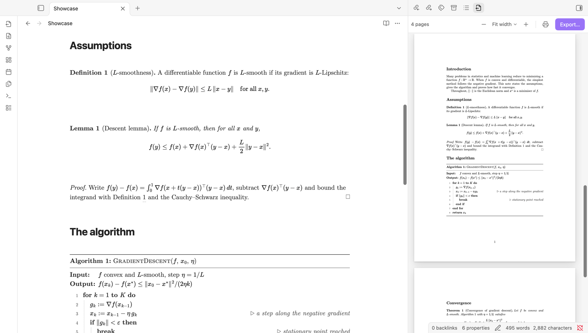
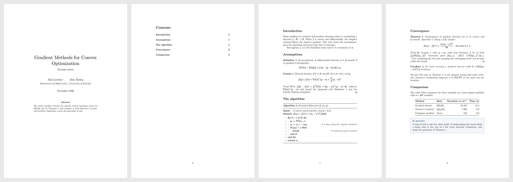
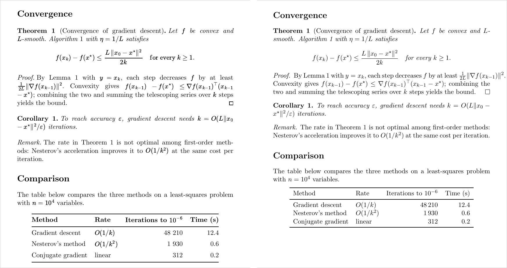
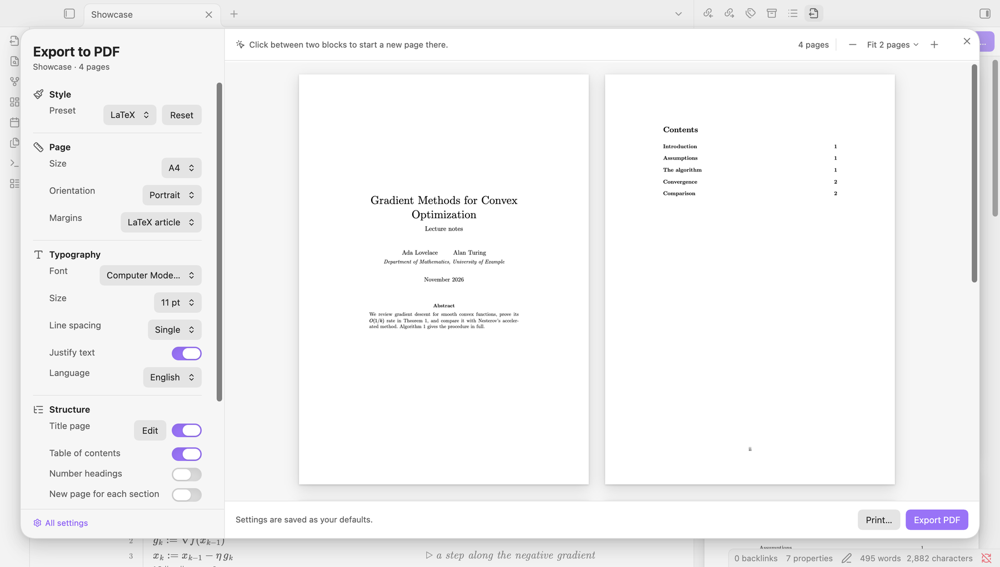
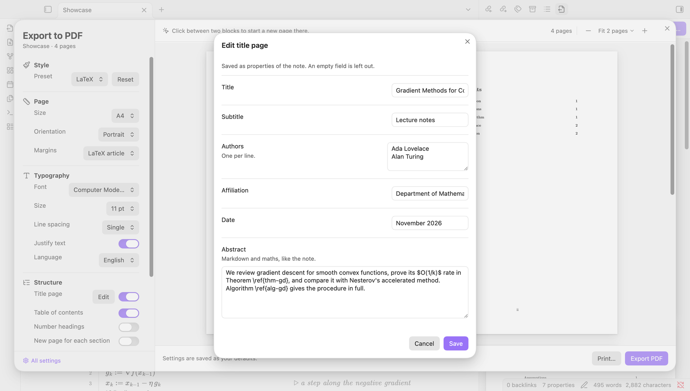
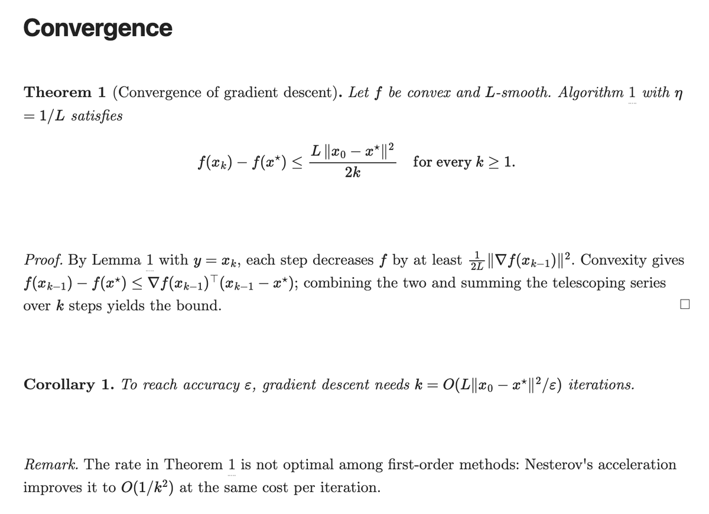
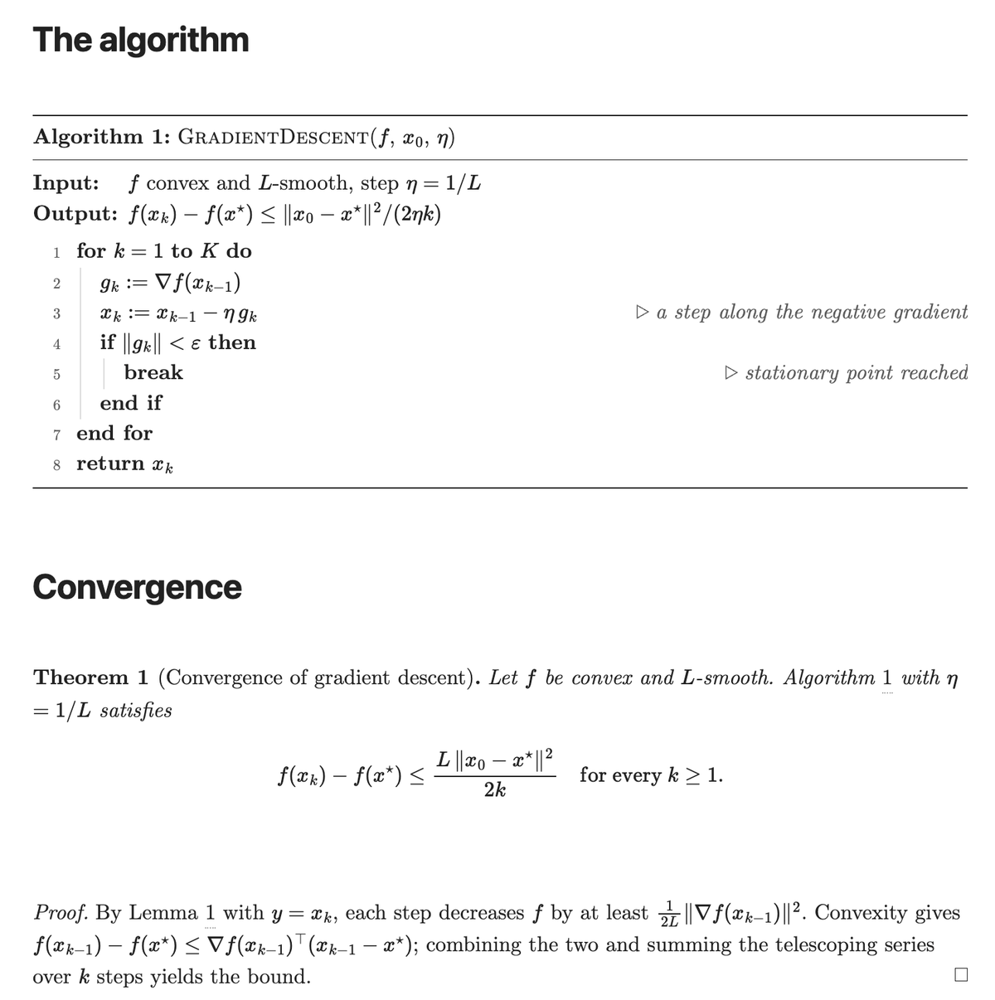
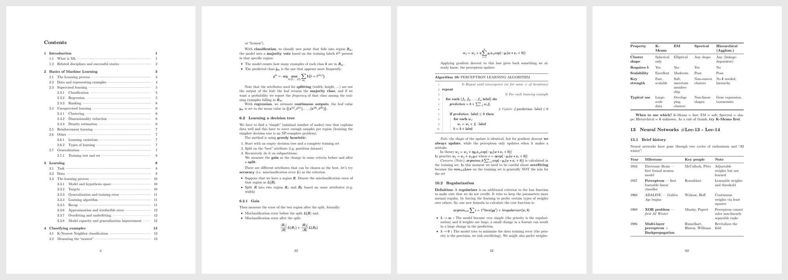
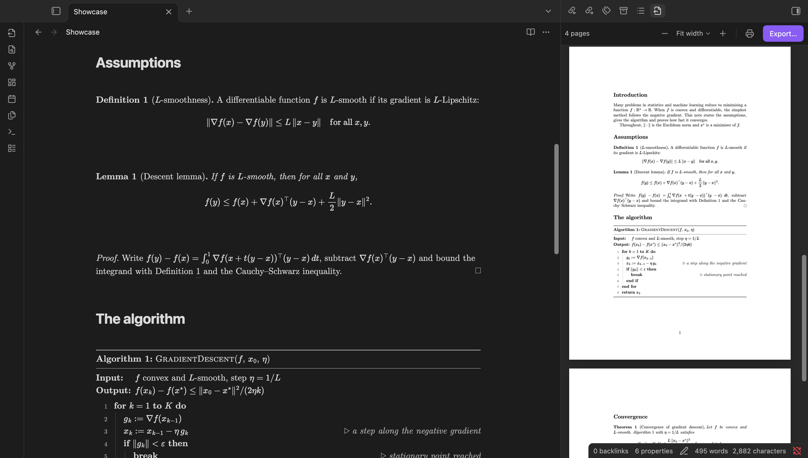

# Academic PDF

LaTeX-quality PDFs straight from Obsidian: Computer Modern typography, theorems and algorithms, Booktabs tables and a table of contents, with no LaTeX to install.



Academic PDF turns a Markdown note into a document that looks typeset with LaTeX. Notes stay plain Markdown: academic structures are ordinary fenced code blocks, readable without the plugin. The preview, the exported PDF and Obsidian's live preview show the same thing.

> **Desktop only.** The PDF is made by the desktop app's print engine (Electron).

Academic PDF is a fork of [Advanced PDF Export](https://github.com/ShrekBytes/advanced-pdf-export) by ShrekBytes. See [Credits](#credits).

## Features

- **LaTeX typography.** Computer Modern (CMU Serif and CMU Typewriter, bundled), justified text with hyphenation in the note's language, LaTeX heading sizes and spacing, and no line break between a formula and the word or punctuation next to it.
- **Theorems and algorithms.** `theorem`, `lemma`, `corollary`, `definition`, `remark` and `proof` blocks, numbered like LaTeX; `algorithm` blocks in the style of algorithm2e, with keywords, line numbers and comments; six coloured boxes. They look the same in live preview as in the PDF.
- **Cross-references.** `\ref{label}` points to any labelled theorem or algorithm and becomes "Theorem 2" or "Algorithm 1", in the note and in the PDF.
- **Title page.** Title, authors, affiliation, date and abstract come from the frontmatter, and can be edited from the export window with **Edit title page**.
- **Table of contents and numbering.** Numbered sections (1, 1.1, 1.1.1), a table of contents over as many pages as it needs, and front pages numbered i, ii, iii with the body from 1. PDF readers show the same page labels and a bookmark outline.
- **Booktabs tables.** Three rules, no vertical lines, columns sized to their content, long tables split across pages with the header repeated.
- **Live PDF preview.** A pane beside the note shows the paginated pages and updates as you type, re-laying out only the pages that changed. Long notes show real progress.
- **Page breaks where you want them.** Hover between two blocks in the preview and click **New page here**. The note gets a `%% page break %%` comment, invisible in reading view.
- **Export or print.** Save a PDF next to the note, or send it to any printer.

## Screenshots

**A whole document.** Title page and abstract from the frontmatter, table of contents with roman page numbers, then the body:



**Next to LaTeX.** The same section through Academic PDF (left) and a standard LaTeX `article` with `amsthm` and `booktabs` (right):



**The export window.** Settings on the left, the pages side by side on the right. **Edit title page** writes the fields back to the note's properties:





**Blocks in live preview.** Theorems, proofs and algorithms render in the editor as they will in the PDF, with working `\ref` numbers:

| | |
|---|---|
|  |  |

**Long notes.** A 101-page course note: numbered sections, a multi-page table of contents, algorithms and Booktabs tables:



**Dark theme.** The interface follows the Obsidian theme; the pages stay white:



## Installation

**From Obsidian:** open **Settings → Community plugins → Browse**, search for **Academic PDF**, then install and enable it.

**By hand:** download `main.js`, `manifest.json` and `styles.css` from the [latest release](https://github.com/bertigiacomo/academic-pdf-obsidian/releases/latest) into `<vault>/.obsidian/plugins/academic-pdf/`, reload Obsidian and enable **Academic PDF** under **Settings → Community plugins**.

## Usage

- **Preview:** click the ribbon icon or run **Academic PDF: Open PDF preview**. The pane follows the active note.
- **Export:** run **Export current note to PDF**, choose **Export to PDF…** from a note's file menu, or click the export icon in the preview. The export window has the most-used settings beside the pages; **Export PDF** opens the save dialog in the note's folder.
- **Print:** run **Print current note**, or use **Print…** in the export window.
- **Insert a block:** run **Insert academic block** or right-click in the editor and choose **Insert academic block…**.

### Academic blocks

````markdown
```theorem
title: Convergence of gradient descent
label: thm-gd
Let $f$ be convex and $L$-smooth. With step $\eta = 1/L$,
$$f(x_k) - f(x^*) \le \frac{\|x_0 - x^*\|^2}{2\eta k}.$$
```

By Theorem \ref{thm-gd}, the error decreases as $O(1/k)$.

```algorithm
label: alg-search
BinarySearch(A, target)
Input: sorted array $A[1 \ldots n]$
  low := 1
  high := n
  while low <= high do
    mid := floor((low + high) / 2)
    if A[mid] == target then
      return mid // found
    end if
  end while
  return -1
Output: the index of $target$, or $-1$
```
````

| Fence | What it is |
|---|---|
| `theorem`, `lemma`, `corollary`, `definition`, `remark` | Numbered statements. The optional `title:` and `label:` lines go first. |
| `proof` | A proof, ended by a square. |
| `algorithm` | Pseudocode. The first line is the name and arguments; `Input:`, `Output:`, `Require:` and `Ensure:` lines are optional; `//` starts a comment; `font: mono` switches to typewriter style. |
| `box-blue`, `box-teal`, `box-green`, `box-purple`, `box-amber`, `box-red` | Coloured boxes, with an optional `title:`. |

### Frontmatter

When **Title page** is on, these frontmatter keys make the title page (or a title block on the first page when it is off):

```yaml
---
title: On the convergence of gradient methods
subtitle: Lecture notes
author: Ada Lovelace and Alan Turing   # or a list under "authors"
affiliation: Department of Mathematics
date: November 2026
lang: en                      # hyphenation language for this note
abstract: >
  Markdown, with maths and \ref, rendered like the body.
---
```

Keys are case-insensitive. When the frontmatter has none of these keys, the PDF shows it as a code block, unless **Hide frontmatter** is on.

### Settings

Everything is under **Settings → Academic PDF**, and the most-used settings are also in the export window:

- **Page:** size, orientation, margins.
- **Typography:** font (Computer Modern by default, or any installed font), size, line spacing, code font, justification, hyphenation language.
- **Structure:** title page, table of contents, numbered headings, a new page for each section.
- **Academic:** numbering of theorems and algorithms, a paper look for blocks in the editor.
- **Header and footer:** page numbers and their format, a running head with `{{title}}` and `{{date}}`.
- **Export:** PDF bookmarks, file name as title, where to save.

## Credits

Academic PDF is a fork of [Advanced PDF Export](https://github.com/ShrekBytes/advanced-pdf-export) 4.8.0 by [ShrekBytes](https://github.com/ShrekBytes), released under the GNU GPL v3. Its pagination engine, Electron export pipeline, PDF outline, MathJax and Mermaid handling are the foundation this plugin is built on. If you want general-purpose PDF export with style presets, use the original.

What this fork changes:

- **Look:** one LaTeX stylesheet with bundled Computer Modern fonts replaces the seven style presets.
- **Academic blocks:** theorem-family, algorithm and box blocks, rendered in Obsidian's live preview and reading view as well as in the PDF.
- **Cross-references:** `\ref{}` with LaTeX-style numbering.
- **Document structure:** title page from the frontmatter (editable in the export window), multi-page table of contents, numbered headings, roman and arabic page numbers with PDF page labels, running heads.
- **Tables and figures:** Booktabs tables with proportional column widths; images that shrink to fit what is left of a page; figure captions.
- **Typography:** justification with language-aware hyphenation, no line breaks next to inline maths, break points in long URLs.
- **Interface:** a live preview pane beside the note with incremental re-layout and progress, a redesigned export window, click-to-insert page breaks (`%% page break %%` replaces `///`), commands and menus.
- **Removed:** the style presets, code syntax themes and background images (no longer in the settings), and the in-app release notes.

## License

[GNU General Public License v3.0](LICENSE). Copyright © ShrekBytes (Advanced PDF Export) and Giacomo Berti (Academic PDF).

The bundled Computer Modern Unicode fonts (CMU 0.7.0, by Andrey V. Panov) are licensed under the SIL Open Font License 1.1: see [src/academic/fonts/OFL.txt](src/academic/fonts/OFL.txt).
